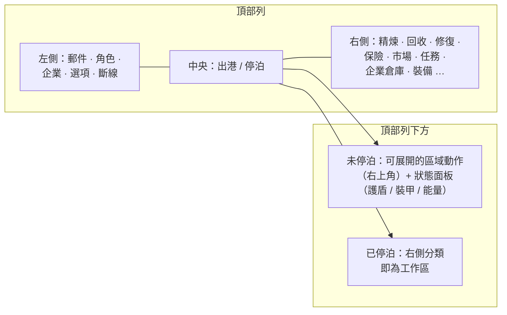

# 客戶端介面總覽

客戶端採用 **EVE Online 風格**介面：全螢幕的太空／區域視圖，搭配可**調整大小與移動的浮動視窗**，可隨時**關閉與重新開啟**。各系統的連線方式請參閱下方連結的頁面。

> 此版面配置為專案提供的運作模型，用於描述各動作的所在位置。實際畫面名稱可能略有差異，但結構為參考依據。

## 頂部列

橫跨螢幕頂部的常駐列。

| 區域 | 內容 |
|---|---|
| **左側** | 主要按鈕：**郵件**、**角色**、**企業**、其他**選項**，以及**斷線** |
| **中央** | **出港 / 停泊**按鈕 — 主要的停泊⇄未停泊切換（參閱[移動](/zh-TW/features/movement/)） |
| **右側** | 動作分類按鈕：**精煉**、**回收**、**修復**、**保險**、**市場**、**任務**（運輸）、**企業倉庫**、**裝備**、… |

右側分類會開啟對應的系統視窗：

| 按鈕 | 開啟 / 功能 | 維基頁面 |
|---|---|---|
| 精煉 | 將原始資源加工為組件 | [生產](/zh-TW/features/production/) |
| 回收 | 將物品分解為基礎材料 | [生產](/zh-TW/features/production/) |
| 修復 | 修復受損的機器人／模組 | [生產](/zh-TW/features/production/) |
| 保險 | 生產／機器人保險方案 | [生產](/zh-TW/features/production/) |
| 市場 | 市場訂單與直接購買 | [市場](/zh-TW/features/market/) |
| 任務 | 運輸任務（貨運） | [運輸](/zh-TW/features/transport/) |
| 企業倉庫 | 企業機庫／倉庫 | [群組](/zh-TW/features/groups/) |
| 裝備 | 為當前活躍機器人配置模組與彈藥 | [機器人](/zh-TW/features/robots/) |

## 停泊狀態

在**已停泊**狀態下，右側的動作分類即為主要工作區：您可以在不離開基地的情況下進行加工、交易、配置與倉庫管理。出港按鈕會將您送出至區域（未停泊的前置條件請參閱[移動](/zh-TW/features/movement/)）。

## 未停泊狀態

在**未停泊**狀態下（駕駛活躍機器人於區域中）：

- **右上角**區域會出現一個**可展開的動作按鈕**：點擊後會向下展開一列額外的區域動作（掃描、採集／互動動作、區域工具 — 即[採集](/zh-TW/features/gathering/)與[戰鬥](/zh-TW/features/combat/)頁面中記載的動作）。
- **主要狀態面板**會顯示您機器人的狀態：**護盾、裝甲／船體、能量**，以及相關戰鬥狀態 — 與[戰鬥](/zh-TW/features/combat/)頁面所引用的資料相同（例如「能量系統完好」的停泊檢查）。
- 僅限基地使用的分類（精煉、市場、…）在重新停泊前無法使用。

## 常見視窗

大多數系統以標準浮動視窗開啟：標題列、關閉按鈕、可調整大小的邊框、分頁或清單內容。重複使用的系統（物品清單／容器、市場、生產線）可同時開啟多個視窗。

- **物品清單 / 容器** — 列出容器內容、移動／堆疊／打包物品、重新命名、丟棄 — 參閱[物品](/zh-TW/features/items/)。
- **角色視窗**（左上角按鈕） — 個人檔案、擴充（研究）、設定、信用點 — 參閱[入門](/zh-TW/features/getting-started/)與[研究](/zh-TW/features/research/)。
- **企業視窗**（左上角按鈕） — 企業資訊、機庫、文件、投票、公告 — 參閱[群組](/zh-TW/features/groups/)。
- **郵件視窗**（左上角按鈕） — 個人郵件與群發郵件 — 參閱[社交](/zh-TW/features/social/)。

## 本維基使用的慣例

- **「頂部列 → X」** = 頂部列上名為 X 的按鈕。
- **「未停泊動作」** = 在區域中時右上角的可展開清單。
- **出港/停泊按鈕** = 頂部列中央的切換按鈕。

<!-- Note: this page is the agreed UI model (project-provided). If the real client
     differs in button names or placement, update this page first — every other
     features/ page references the conventions defined here. -->