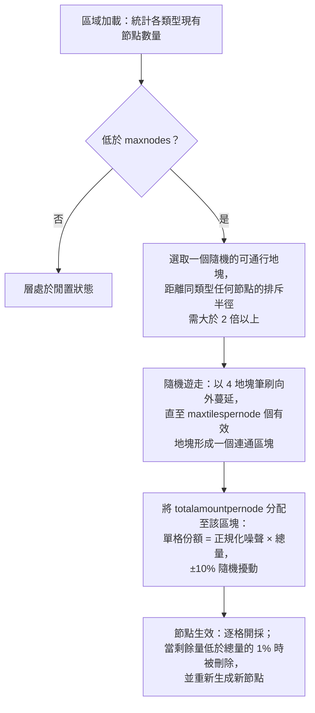

# 區域資源生成機制

本頁面詳細說明伺服器如何維持區域內的資源儲量。當區域被載入到記憶體中時，這兩大資源生態
系統會在背景持續運行；它們的週期性運轉無需玩家進行任何操作觸發。

## 區域資源配置

每個區域在資料庫中都透過兩個獨立的配置清單進行定義：

- **礦石配置** (`mineralconfigs`) — 區域內存在的每種礦石對應一行記錄，包含四個控制參數：
  | 列名 | 含義 |
  |---|---|
  | `maxnodes` | 區域維持該類型礦石的節點數量 |
  | `maxtilespernode` | 單個礦石節點最多可覆蓋的地塊數量 |
  | `totalamountpernode` | 新生礦點中分佈在其所有地塊上的資源總量 |
  | `minthreshold` | 最低單格填充比例（0–1）；開採後低於該比例的地塊將被丟棄 |
- **植物配置** (`zones.fertility` + 植物規則集) — 區域的目標植物覆蓋率（百分比）以及允許在該區域生長的植物物種清單（每個物種的行為定義在規則檔案中，詳見[植物](/zh-TW/content/plants/)）。

未配置礦石的區域（競技場、新手訓練區、要塞以及部分 Gamma 區域）完全不存在礦石層。

## 礦石節點

### 節點的生成與放置

當一個區域載入時，每種礦石類型的圖層會統計其現有節點數量（持久化儲存在 `mineralnodes`
表中），並不斷生成新節點，直至達到 `maxnodes`。新節點的放置採用**隨機遊走** (random walk)
演算法：

1. 隨機選取一個可通行的地塊。
2. 該地塊必須遠離同類型最近的現有節點 — 排斥半徑根據 `maxtilespernode` 計算得出
   （`√(maxtilespernode/π) × 2`，起始點到現有節點的距離必須至少達到該半徑的 2 倍），
   以確保節點不會融合成超大型礦脈。
3. 從起始地塊開始，隨機向外擴散遊走（每次以 4 個地塊大小的筆刷進行擴散），收集最多
   `maxtilespernode` 個有效通行地塊，組成一個連通的區塊。
4. 節點的 `totalamountpernode` 資源儲量被分散到該區塊的所有地塊上：每個地塊分配到的份額
   等於其（正規化）噪聲值乘以總量，並帶有 ±10% 的隨機擾動，因此同類型的兩個節點外觀絕不會完全相同。

地塊只有在滿足以下條件時才被視為節點的有效放置地：位於區域邊界內、非島嶼、未受到
PBS 地形改造保護且可通行。兩種稀有礦石在停靠基地和躍遷裂隙門周圍設有**隔離禁區**：
**epriton** 保持最小安全距離，而 **flux 礦**保持該距離的兩倍 — 因此 flux 礦絕對不會出現在基地正旁邊。

### 節點的消耗機制

- 採礦作業逐格提取地塊中的資源材料。
- 當節點的剩餘量低於其**配置總量的 1%** 時，該節點將被刪除，並重新生成一個全新的節點
  （返回步驟 1），從而使區域始終維持 `maxnodes` 的數量。
- 此外，開採 flux 礦節點還會觸發 **NPC 生成** — 正在被開採（或刪除）的節點會向 NPC 系統
  發布事件廣播，這也是 flux 礦區總是引來大量敵對 NPC 圍攻的原因。

## 植物生態

### 植物掃描機制

區域被劃分為 **32×32 地塊**的邏輯區域。植物處理模組會按順序遍歷這些地塊，每 tick 處理一塊，
其掃描速率經過專門調配，使得**遍歷整個區域大約需要 8 小時**（各區域可獨立覆蓋此時間）。
每個 32×32 的「資料立方」 (cube) 都會經過固定的管線處理：

1. **驗證** — 清理無效植物（地面類型錯誤、死亡、錯位）。
2. **生長** — 推進每株植物的生長階段（關於 `growRate` 與結果機制，請參閱[資源採集](/zh-TW/features/gathering/)）。
3. **生成** — 在立方內植物密度未達肥沃度目標值的位置生成新植物。
4. **阻擋衰減** — 植物的阻擋碰撞高度隨時間衰減。
5. **間距剔除** — 強制執行同物種間距限制 (`killDistance`)。
6. **果實再生** — 恢復少量的可採摘果實資源。

### 新植物的選擇與生成

地塊只有在區域檔案中包含**生成潛能**（區域植物圖層中硬編碼的單格位元組資料；0 表示該地塊永遠不會發芽）
時才能長出新植物。在每個 tick 中，對於每個符合條件的地塊：

- **優先進行區域肥沃度檢測**：若該立方內的阻擋植物覆蓋率已達到其陸地地塊的 `fertility%`，則不再生成任何新植物。
- **單格觸發機率**：隨機抽籤點數必須超過地塊的生成潛能值。
- **物種篩選**：
  - 若該地塊**周圍沒有相鄰植物**，則按權重隨機抽取物種，各允許物種的權重為其 `fertility` 參數（玩家人工播種的物種被排除在自然生成之外）。
  - 若該地塊**周圍已有植物**，則進行拋硬幣二選一：50% 機率直接複製當前*占主導地位*的鄰近物種（周邊數量最多的物種），50% 機率按各物種的 `(鄰近數量 × spreading)` 進行**擴散**加權抽取 — 這正是同種植物傾向於形成大片聚集斑塊的原因。
- **上限與間距限制**：若某個物種已達到其 `maxAmount` 區域上限，則跳過該物種；若地塊處於另一株同類植物的 `killDistance` 範圍內，同樣予以跳過。

### 對玩家的意義

- 植被密度受區域肥沃度嚴格限制 — 肥沃度為 20 的區域，植被覆蓋率絕不會達到 100%。
- 植物呈群落聚集分佈是常態：擴散機制促使各物種擴展自身領地，因此區域生態表現為明顯的物種聚落，而非均勻散布。
- 具有 `killDistance` 屬性的物種（如特定高價值植物）間距均勻，一旦發現一株，便能推測出其他植株的大致分佈。
- 新礦點由隨機遊走落點決定 — 區域中沒有固定不變的「富礦點」；尋找礦脈必須使用地球物理掃描（參見[資源採集](/zh-TW/features/gathering/)）。

<!-- Developer notes: TerrainsModule.cs (per-zone layer construction: OreLayer for
     Solid, LiquidLayer for Liquid, GravelLayer for TrainingZone; LoadMineralNodes
     top-up); MineralLayer.cs (LoadMineralNodes: delete <1% nodes, generate to
     maxnodes; FluxOre -> OreNpcSpawnMessage on decrease/expiry);
     Generators/MineralNodeGeneratorBase.cs (FindStartPosition keep-out + spacing,
     NormalizeNoise, CreateMineralNode jitter); RandomWalkMineralNodeGenerator.cs
     (flood-fill brush 4, 50k step cap); MineralNodeRepository.cs (mineralnodes table,
     compressed per-tile values); PlantHandler.cs (32x32 areas, 8h full pass,
     PlantsGrowthTimerOverrideMin, scanner modes); NatureCube.cs (ProcessAll pipeline,
     SpawnPlants fertility/spawn/killDistance logic, GetNewPlantRule 50/50 ruling vs
     spreading); PlantRuleExtensions.cs (fertility-weighted + spreading-weighted
     draws); PlantInfo.cs (per-tile spawn byte comes from the zone's plant layer
     file, never assigned by server code). -->
