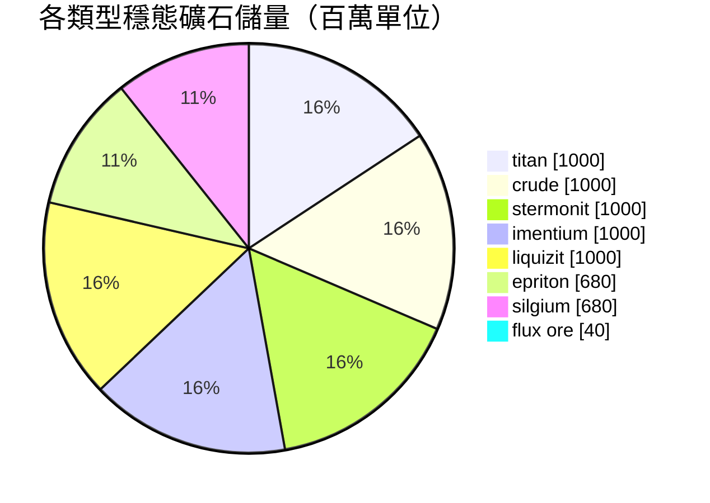

# Daoden (zone_ASI) — 案例分析

  <a href="/zh-TW/zones/map/">
    
    <strong>世界地圖</strong> — 該區域在全局中的位置及躍遷裂隙門連接。點擊打開完整地圖。
  </a>

圖示標明了該區域躍遷裂隙柱的分佈位置（圓點，標註目標終點；柱體當前關閉時顯示為灰色）、
從其他區域躍遷抵達的降落點（虛線圓圈）以及出口閘門（菱形，若存在）。標繪位置均為
伺服器記錄的地塊座標。
虛線連接了區域內成對的本地躍遷裂隙柱。

Alpha 等級**開放 PvP** 區域 — 擁有全遊戲最豐富的礦產配置，也是稀有資源的發源地。
New Virginia 擁有的一切這裡應有盡有，此外還孕育著 epriton、silgium 以及會招致 NPC
瘋狂襲擊的 flux 礦區。

| 項目 | 屬性值 |
|---|---|
| 區域 ID | 2 |
| 類型 | PvP（開放） |
| 安全等級 | [Beta](/zh-TW/zones/protection/) — 開放 PvP，標準地形 |
| 尺寸 | 2048 × 2048 地塊 |
| 肥沃度 | 20 |
| 植物規則集 | 2 — 19 種（含高階可採伐植物） |
| 礦石類型 | 8 種（titan, crude, stermonit, imentium, liquizit, epriton, silgium, flux ore） |
| 礦點總數 | 64（每種 8 個） |

## 礦物配置

| 礦物材料 | 節點數 | 最大地塊/節點 | 每節點總量 | 最低閾值 |
|---|---|---|---|---|
| [titan](/zh-TW/content/ores/titan/) | 8 | 500 | 125,000,000 | 0.5 |
| [crude](/zh-TW/content/ores/crude/) | 8 | 1257 | 125,000,000 | 0.5 |
| [stermonit](/zh-TW/content/ores/stermonit/) | 8 | 500 | 125,000,000 | 0.5 |
| [imentium](/zh-TW/content/ores/imentium/) | 8 | 500 | 125,000,000 | 0.5 |
| [liquizit](/zh-TW/content/ores/liquizit/) | 8 | 500 | 125,000,000 | 0.5 |
| [epriton](/zh-TW/content/ores/epriton/) | 8 | 500 | 85,000,000 | 0.5 |
| [silgium](/zh-TW/content/ores/silgium/) | 8 | 500 | 85,000,000 | 0.5 |
| [fluxore](/zh-TW/content/ores/fluxore/) | 8 | 300 | 5,000,000 | 0.5 |

顯著特徵：

- **節點總數是 New Virginia 的 8 倍**，但單節點規模更小（500 地塊對比 1000 地塊）：
  標準礦石的遊走半徑從 34 降至 24 地塊。在此處地球物理掃描更加重要 — 礦點儲層更薄且更加零散。
- **Epriton 與 silgium** 單節點總量縮減（8500 萬對比 1.25 億） — 價值更高，分佈更稀少。
  此外，epriton 與基地和躍遷裂隙門保持**最小安全隔離距離**，因此其礦點絕不會出現在出生點旁。
- **Flux 礦屬於極端特例**：300 地塊內單節點僅有 500 萬總量（每格約 16,600 單位 — 細如溪流而非礦脈），
  全圖 8 個節點，且與基地保持 **2 倍於 epriton** 的隔離禁區。開採 flux 節點會向 NPC 系統發布
  事件廣播 — flux 礦點從設計之初就是兵家必爭之地（請參閱[入侵與 NPC 系統](/zh-TW/features/intrusion/)）。
- 穩態礦石儲量：全區域總量約 64 億單位。

## 植物生態組合

規則集 2 允許 19 種植物物種 — 具備完整的 Alpha 級生態構成：基礎植物，加上 **devrinol**、
**wall**、**titanplant** 以及**高階可採伐經濟植物**（高階 electroplant、高階 iron tree、
高階 rustbush、高階 slimeroot）。肥沃度依然是 20，因此整體植被密度與 New Virginia 相同 — 
不同之處在於*哪些*物種能夠贏得肥沃度抽取。高階採伐植物自帶的 `fertility` 權重決定了它們在與野草
競爭出苗時的勝率。

各物種規則詳見[植物](/zh-TW/content/plants/)；各礦石產出數據詳見[礦石](/zh-TW/content/ores/)。

## 對玩家的意義

- 開放完整的礦產進階鏈，包括 flux 礦經濟 — 但此處為開放 PvP 環境，你開採的一切財富都可能被掠奪
  （關於基地間安全調配物資的指南，請參閱[運輸](/zh-TW/features/transport/)）。
- 在 flux 礦節點附近需做好應對 NPC 壓迫的準備；生成系統時刻監視這些礦節點的開採事件。
- 此處的植物採伐重點在於高階變種，其果實產出品質顯著優於初始區域的低階物種。

<!-- Developer notes: zones row id 2 (zonetype 2 = PvP, protected 0, fertility 20,
     plantruleset 2); mineralconfigs 8 rows (7 standard + fluxore 8/300/5M);
     MineralNodeGeneratorBase.KeepOutDist: Epriton = MINERAL_DISTANCE_FROM_BASE_MIN,
     FluxOre = 2x; MineralLayer.OnNodeDecrease/OnNodeExpired -> OreNpcSpawnMessage for
     FluxOre; plantrules rulesetid 2 = 19 files (4 harvestable, incl. devrinol and
     wall). -->
