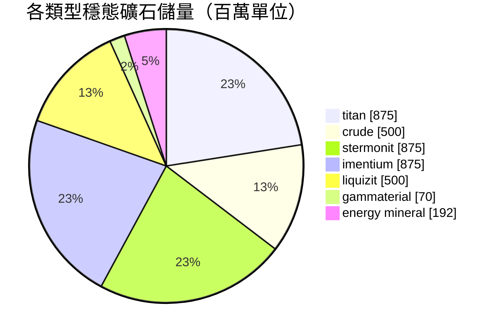

# zone_gamma_z106 — 案例分析

  <a href="/zh-TW/zones/map/">
    
    <strong>世界地圖</strong> — 該區域在全局中的位置及躍遷裂隙門連接。點擊打開完整地圖。
  </a>

圖示標明了該區域躍遷裂隙柱的分佈位置（圓點，標註目標終點；柱體當前關閉時顯示為灰色）、
從其他區域躍遷抵達的降落點（虛線圓圈）以及出口閘門（菱形，若存在）。標繪位置均為
伺服器記錄的地塊座標。

高等級**開放 PvP** 區域：可進行地形改造、低肥沃度、二階植物變種以及更緊縮的礦業生態。
這代表了區域的「大後期」形態 — 資源更少，爭奪更加白熱化。

| 項目 | 屬性值 |
|---|---|
| 區域 ID | 106 |
| 類型 | PvP（開放） |
| 安全等級 | [Gamma](/zh-TW/zones/protection/) — 開放 PvP，可地形改造 |
| 尺寸 | 2048 × 2048 地塊 |
| 肥沃度 | 15 |
| 可地形改造 | 是（PBS 科技限制 2） |
| 植物規則集 | 22 — 17 種（"Gamma Plant Rules"，二階組合） |
| 礦石類型 | 7 種（titan, crude, stermonit, imentium, liquizit, gammaterial, energy mineral） |
| 礦點總數 | 44 |

## 礦物配置

| 礦物材料 | 節點數 | 最大地塊/節點 | 每節點總量 | 最低閾值 |
|---|---|---|---|---|
| [titan](/zh-TW/content/ores/titan/) | 7 | 600 | 125,000,000 | 0.5 |
| [crude](/zh-TW/content/ores/crude/) | 4 | 600 | 125,000,000 | 0.5 |
| [stermonit](/zh-TW/content/ores/stermonit/) | 7 | 600 | 125,000,000 | 0.5 |
| [imentium](/zh-TW/content/ores/imentium/) | 7 | 600 | 125,000,000 | 0.5 |
| [liquizit](/zh-TW/content/ores/liquizit/) | 4 | 600 | 125,000,000 | 0.5 |
| [gammaterial](/zh-TW/content/ores/gammaterial/) | 7 | 100 | 10,000,000 | 0.5 |
| [energymineral](/zh-TW/content/ores/energymineral/) | 8 | 300 | 24,000,000 | 0.5 |

顯著特徵：

- **礦點數少於 Alpha 區域**（全圖 44 個節點對比 Daoden 的 64 個）：crude 與 liquizit 銳減
  至各自僅 4 個節點。單節點總量與 Alpha 標準礦石相同，因此穩態總儲量（約 39 億單位）更為緊缺，
  且再生週期更長。
- **兩種特異礦石**：極小型的 100 地塊 **gammaterial** 礦點（遊走半徑僅 10 地塊 — 規模小且極易被發現，
  單節點儲量約 140 萬）以及單節點儲量 2400 萬的 **energy mineral**。
- 無 epriton，無 flux 礦 — 稀有經濟礦石仍保留在 Alpha 等級區域中。

## 植物生態組合

規則集 22 允許 17 種植物物種：包含基礎植物，加上**二階變種** — 野生可採伐的高階 iron tree t2
與高階 rustbush t2，以及**二階播種植物**（高階 electroplant t2、高階 slimeroot t2）。播種植物
帶有 `playerSeeded` 標記 — 它們**絕不會**自然生成；僅存在於玩家培育的苗圃園林中
（請參閱[資源採集 → 植物](/zh-TW/features/gathering/)）。

肥沃度為 **15**（而非 20）：一個 32×32 的立方體內最多容納約 15% 的阻擋植物，因此植被覆蓋率
明顯比 Alpha 區域稀疏，在立方體達到「飽和」前，肥沃度抽取可填補的生長空間也更小。

各物種規則（包括二階果實產出量）詳見[植物](/zh-TW/content/plants/)；各礦石產出數據詳見[礦石](/zh-TW/content/ores/)。

## 對玩家的意義

- 更加緊缺、週轉更慢的經濟體系：常規礦石節點數量更少意味著採礦壓力會更快顯現 — 採空的 crude
  油田需要區域花費更長時間才能補充再生。
- 植被更加稀疏：在 15% 肥沃度下，開闊平原是常態，植物斑塊反而屬於特例。
- 此處的高價值採集為野生的二階 iron tree / rustbush，以及玩家在私家園林中種植培育的二階 electroplant 與 slimeroot。
- 地形改造（PBS 科技限制 2）意味著地貌本身可以被玩家重塑改變（請參閱[能量基站 (PBS)](/zh-TW/features/pbs/)）。

<!-- Developer notes: zones row id 106 (zonetype 2 = PvP, protected 0, fertility 15,
     terraformable 1, pbsTechLimit 2, plantruleset 22); mineralconfigs 7 rows (crude
     and liquizit 4 nodes each); plantrules rulesetid 22 = 17 files, note "Gamma
     Plant Rules"; electroplant_seeded_t2.txt / slimeroot_seeded_t2.txt set
     playerSeeded=n1 (inherited via source= from electroplant_hi.txt /
     slimeroot_hi.txt) -> excluded from natural spawns in
     PlantRuleExtensions.GetWinnerPlantTypeBasedOnFertility. -->
