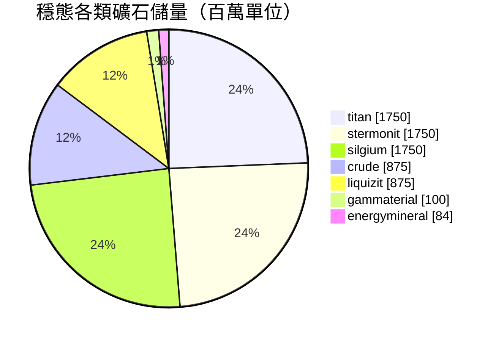

<!-- Generated by tools/generate from the live database (source: zones, mineralconfigs, plantrules, teleportdescriptions, strongholdexitconfig).
     Do not edit by hand; regenerate instead. -->
# zone_gamma_z109

  <a href="/zh-TW/zones/map/">
    
    <strong>世界地圖</strong> — 該區域在所有區域中的位置及傳送連接。打開完整地圖。
  </a>

本區域傳送柱位置（帶目標標記的點 — 當前關閉的柱子呈暗淡顯示）、來自其他區域的傳送著陸點（虛線圓圈）以及出口通道（菱形）。座標為伺服器記錄的網格座標。

frontier belt的開放PvP且可地形改造（Gamma）島嶼 — 地形可由玩家重塑。 維持7種礦石類型。

| 項目 | 數值 |
|---|---|
| 區域ID | 109 |
| 類型 | PvP |
| 保護 | [Gamma](/zh-TW/zones/protection/) — 開放PvP，可地形改造 |
| 尺寸 | 2048×2048 格 |
| 階級 (Tier) | T1 (伺服器記錄) |
| 肥沃度 | 15 |
| 植物物種 | 17 (規則集 31) |
| 礦石類型 | 7 |
| 礦石節點總數 | 57 |
| PBS科技限制 | 1 |
| 最大停靠基地數 | 2 |

## 礦石配置

該區域維持的礦石節點生成。每種礦石的產出和生成公式請參閱[礦石](/zh-TW/content/ores/)（該區域的對應部分見下方鏈接）。

| 材料 | 節點 | 最大格數/節點 | 單節點總量 | 最小閾值 |
|---|---|---|---|---|
| [titan](/zh-TW/content/ores/titan/) | 10 | 600 | 175M | 0.5 |
| [crude](/zh-TW/content/ores/crude/) | 5 | 600 | 175M | 0.5 |
| [stermonit](/zh-TW/content/ores/stermonit/) | 10 | 600 | 175M | 0.5 |
| [liquizit](/zh-TW/content/ores/liquizit/) | 5 | 600 | 175M | 0.5 |
| [silgium](/zh-TW/content/ores/silgium/) | 10 | 600 | 175M | 0.5 |
| [gammaterial](/zh-TW/content/ores/gammaterial/) | 10 | 100 | 10M | 0.5 |
| [energymineral](/zh-TW/content/ores/energymineral/) | 7 | 300 | 12M | 0.5 |

[區域索引](/zh-TW/zones/zone-index/) · [世界地圖](/zh-TW/zones/map/#t1) · [保護級別](/zh-TW/zones/protection/)
