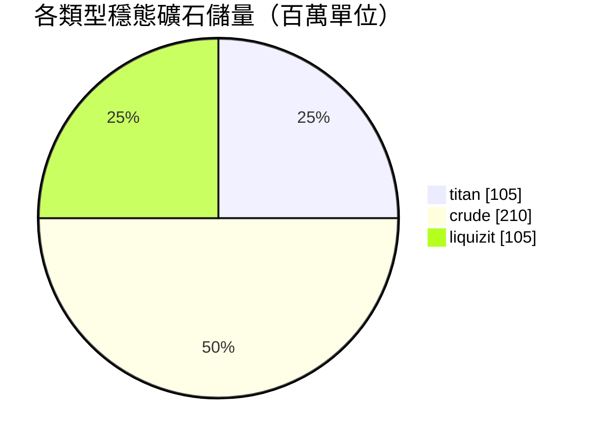

# New Virginia (zone_TM) — 案例分析

  <a href="/zh-TW/zones/map/">
    
    <strong>世界地圖</strong> — 該區域在全局中的位置及躍遷裂隙門連接。點擊打開完整地圖。
  </a>

圖示標明了該區域躍遷裂隙柱的分佈位置（圓點，標註目標終點；柱體當前關閉時顯示為灰色）、
從其他區域躍遷抵達的降落點（虛線圓圈）以及出口閘門（菱形，若存在）。標繪位置均為
伺服器記錄的地塊座標。
虛線連接了區域內成對的本地躍遷裂隙柱。

低等級**受保護 PvE** 區域 — 供新角色採集資源的避風港。其配置展現了整個體系中最簡練的一端：
礦石種類少、礦點規模大、基礎植物組合。

| 項目 | 屬性值 |
|---|---|
| 區域 ID | 0 |
| 類型 | PvE（受保護） |
| 安全等級 | [Alpha](/zh-TW/zones/protection/) — 受保護，已禁用 PvP |
| 尺寸 | 2048 × 2048 地塊 |
| 肥沃度 | 20 |
| 植物規則集 | 0 — 15 種（基礎 "tm pve" 組合） |
| 礦石類型 | 3 種（titan, crude, liquizit） |
| 礦點總數 | 21（每種 7 個） |

## 礦物配置

| 礦物材料 | 節點數 | 最大地塊/節點 | 每節點總量 | 最低閾值 |
|---|---|---|---|---|
| [titan](/zh-TW/content/ores/titan/) | 7 | 1000 | 15,000,000 | 0.5 |
| [crude](/zh-TW/content/ores/crude/) | 7 | 1257 | 30,000,000 | 0.5 |
| [liquizit](/zh-TW/content/ores/liquizit/) | 7 | 1000 | 15,000,000 | 0.5 |

顯著特徵：

- **礦點龐大而稀疏** — 每個節點覆蓋 1000–1257 個地塊（遊走半徑 `(int)√(tiles/π)×2` = 34–40 個地塊），
  因此每個節點都是大片礦斑，且全區域每種礦石僅維持 7 個節點。穩態礦石儲量總計約 4.2 億單位
  （1.05 億 titan + 2.1 億 crude + 1.05 億 liquizit）。
- **無稀有礦石** — 無 epriton，無 flux 礦，因此基地區域周圍沒有隔離禁區，也不會有引來 NPC 圍攻的礦點。
- `minthreshold` 為 0.5 意味著只有當節點在該處的噪聲填充量達到最大值的至少一半時，地塊才具備開採價值 — 每個礦斑邊緣均較為稀薄。

各類礦石的提煉產出（單位礦石精煉所得產物以及上述數據背後的節點生成公式）請參閱[礦石](/zh-TW/content/ores/)。

## 植物生態組合

規則集 0 允許 15 種植物物種 — 屬於基礎初始生態配置：草 (a/b)、松樹、灌木 (a/b)、
rango、銅樹、蘆葦、奈米小麥、低階 rustbush / slimeroot / electroplant、盆景以及低階鐵樹。
不含牆體、不含 devrinol，也不含高階可採伐經濟植物。

在肥沃度為 20 的設定下，一個 32×32 的立方體內最多容納約 20% 的阻擋植物；在整張 2048×2048
的地圖上，理論上限大約為 838,000 個植物地塊（實際數量更少，因為水域與島嶼不屬於陸地）。
物種篩選按照各規則的 `fertility` 屬性進行加權，因此基礎野草和灌木佔據絕對主導地位，而低階可採伐經濟植物非常罕見。

每個物種的完整屬性規則（growRate、果實產出、生命值）請參閱[植物](/zh-TW/content/plants/)。

## 對玩家的意義

- 安全的新手經濟圈：三種常見礦石形成巨大且易於掃描探查的礦斑。
- 此處的可採伐植物均為低階變種 — 高價值植物（高階 electroplant / iron tree / rustbush / slimeroot）僅在後續高級區域出現。
- 由於該區域處於保護之下，採集循環中完全沒有 PvP 風險（關於進入區域的相關規則，請參閱[移動與導航](/zh-TW/features/movement/)）。

<!-- Developer notes: zones row id 0 (zonetype 1 = PvE, protected 1, fertility 20,
     plantruleset 0); mineralconfigs 3 rows (titan/crude/liquizit, 7 nodes each);
     plantrules rulesetid 0 = 15 files, note "tm pve". Node radius formula and
     threshold semantics: see generation.md. -->
